# Integrate with RAGFlow

RAGFlow can integrate with GPUStack to leverage locally deployed LLMs, vision models, embeddings, reranking, Speech-to-Text and Text-to-Speech capabilities. RAGFlow discovers the models running in GPUStack, so you connect once and choose which ones to add.

!!! note

    This guide requires a RAGFlow version later than v1.0.0-rc3, which adds the GPUStack setup card.

## Deploying Models

1. In GPUStack UI, navigate to the `Deployments` page and click on `Deploy Model` to deploy the models you need. Keep `Enable Model Route` selected, because RAGFlow only discovers models that are running and have a route. Here are some example models:

    | Model | Used in RAGFlow as |
    | --- | --- |
    | `qwen3-4b` | Chat |
    | `qwen2.5-vl-3b-instruct` | Chat + Vision |
    | `bge-m3` | Embedding |
    | `bge-reranker-v2-m3` | Rerank |
    | `faster-whisper-small` | Speech to text |
    | `cosyvoice2-0.5b` | Text to speech |

2. Wait until each model shows its replicas as ready:

    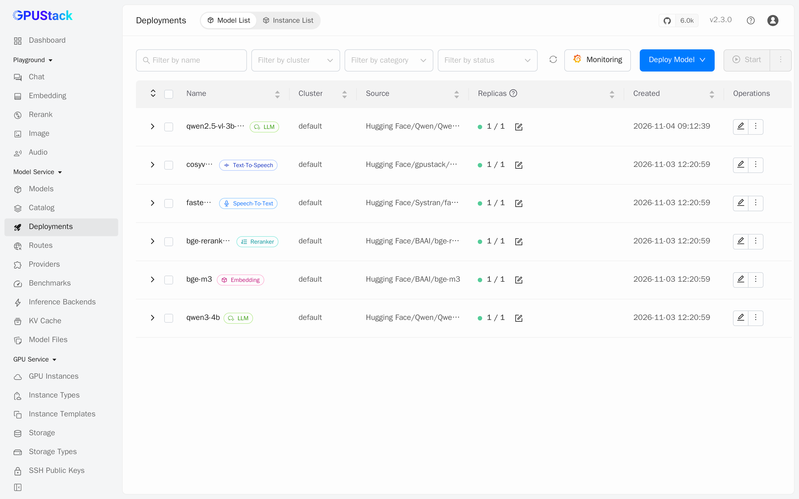

## Create an API Key

1. Navigate to the `Access Control` > `API Keys` page, then click on `Add API Key`.

2. Fill in the name and keep `Model Access` selected with `All models` under `Access Permissions`. The default `Expiration` is `1 month`, so choose a longer period if RAGFlow will keep using this key. Then click `Save`.

    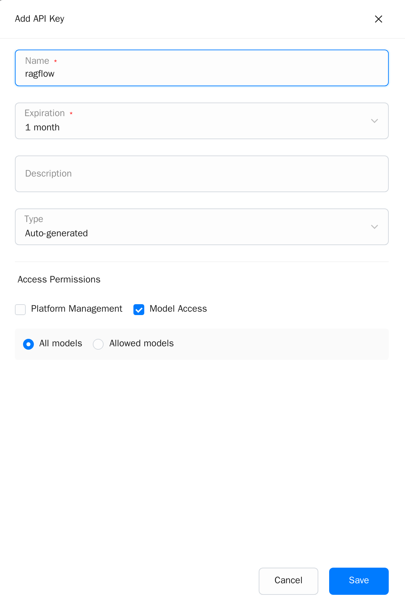

3. Copy the API key and save it for later use. The `API Keys` page only shows a masked value afterwards.

## Integrating GPUStack into RAGFlow

1. Access the RAGFlow UI, click the avatar in the top right corner to open `Model providers`, then select `GPUStack` under `Available models`.

2. Fill in the following fields, then click `Connect`:

    - Instance name: Any name that identifies this GPUStack server in RAGFlow, for example `gpustack`.
    - GPUStack server URL: `http://your-gpustack-url`, without the `/v1` path. Include the port if you use a custom one. Do not use `localhost`, as it refers to the RAGFlow container. If GPUStack runs on the same host as RAGFlow, you can use `http://host.docker.internal:<port>`.
    - API key: The API key you copied in the previous steps.

3. RAGFlow lists the running models, grouped by type and with their context length. Clear the checkbox of any model you do not want to add. GPUStack does not report whether a model accepts images, so set vision models such as `qwen2.5-vl-3b-instruct` to `Chat + Vision`:

    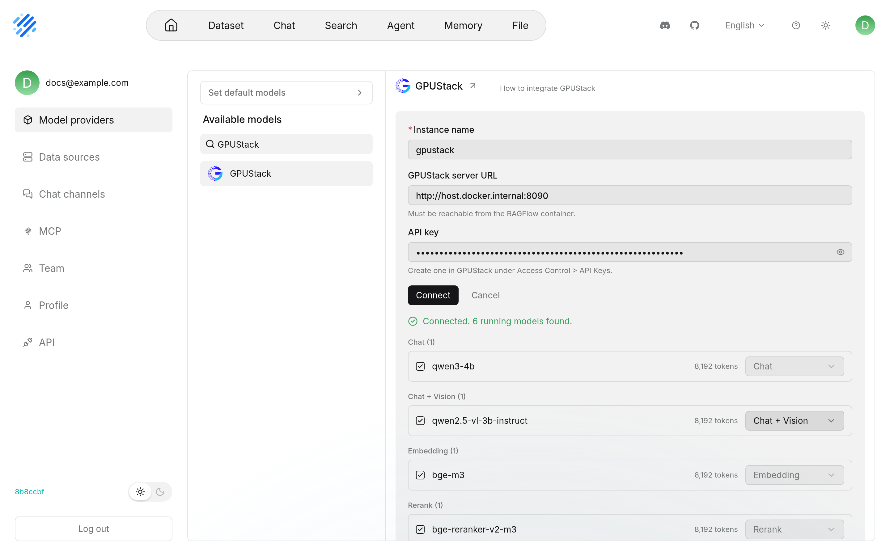

    If the connection fails, RAGFlow shows the reason below the form:

    - `GPUStack rejected this API key.`: Check the API key under `Access Control` > `API Keys`.
    - `Cannot reach this server from RAGFlow.`: Check the URL and port from inside the RAGFlow container. For example, run the following command in the RAGFlow `docker` directory, which should return `"ok"`:

        ```bash
        docker compose exec ragflow-cpu curl http://your-gpustack-url/healthz
        ```

4. Click `Add 6 models` at the bottom of the list (the number follows your selection). The added models appear in the instance:

    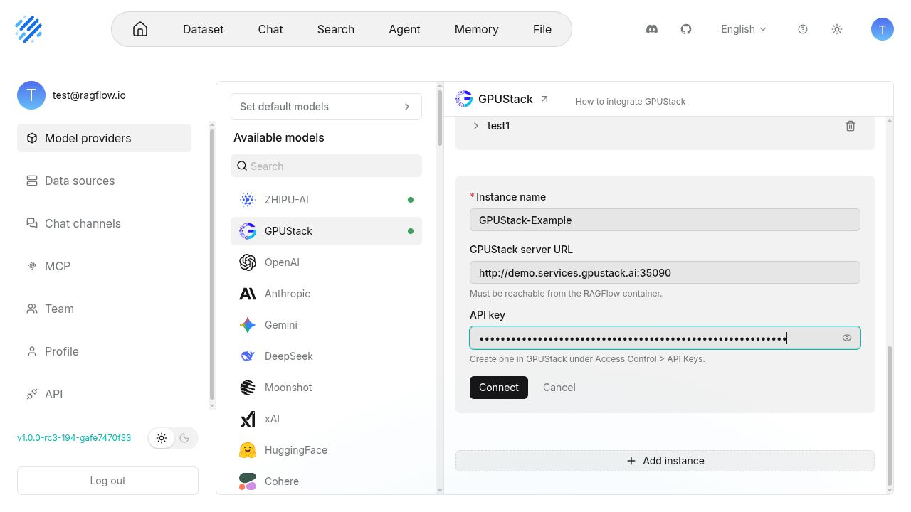

    If you deploy more models in GPUStack later, click `Refresh` on the instance to discover and add them.

5. Click `Set default models` and select a model for each type. Each selection is saved immediately:

    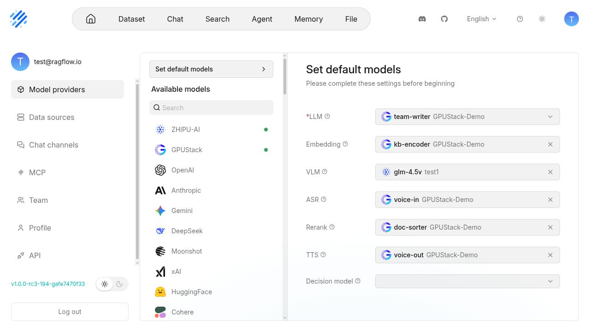

## Using the Models

You can now use the models in `Dataset` and `Chat`. Here is a simple case:

1. Go to `Dataset` and create a dataset. The default embedding model is already selected:

    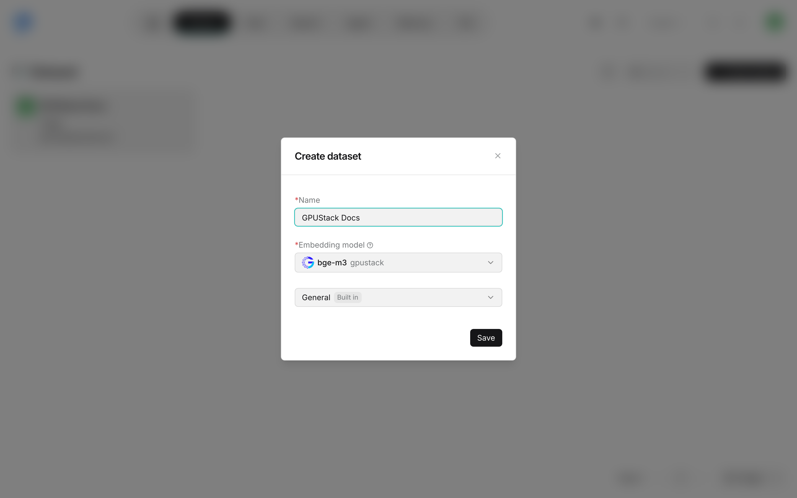

2. Click `Add file` > `Upload file`, turn on `Parse on creation`, select your file and click `Save`. When parsing finishes, the file shows its number of chunks:

    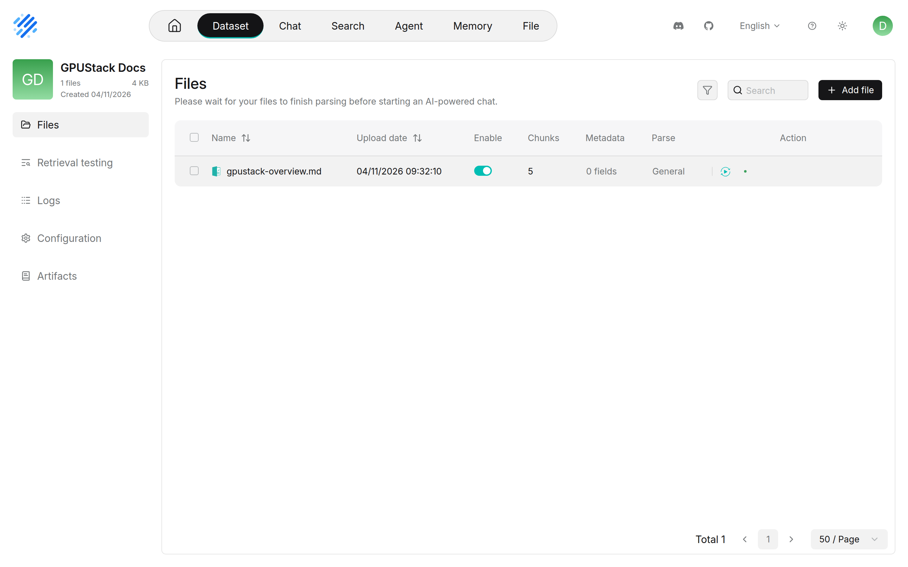

3. Navigate to `Retrieval testing`, set `Rerank model` to `bge-reranker-v2-m3`, enter a question and click `Run`:

    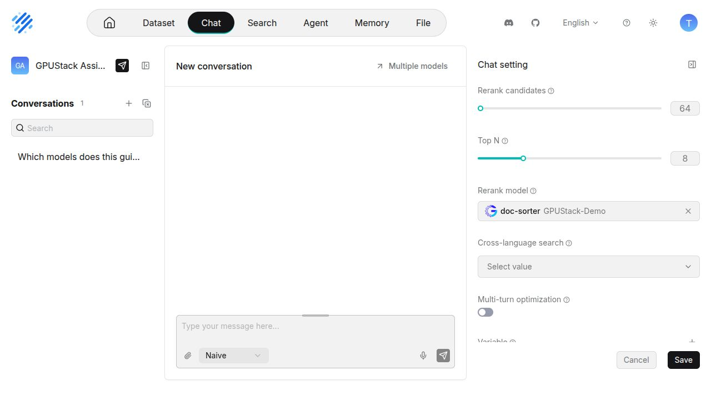

4. In `Chat`, create a chat and open it. Click the settings icon in the top right corner, select the dataset under `Datasets`, check the chat model under `Model`, and click `Save`:

    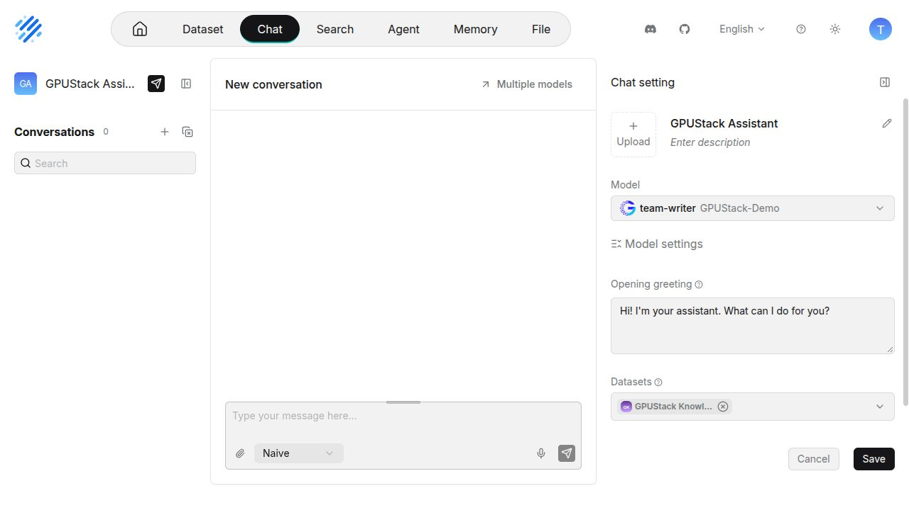

    The rerank model chosen in `Retrieval testing` does not apply to chats. To rerank a chat's retrieval, expand `Advanced settings` > `Naive` in the same settings, set `Rerank model` to `bge-reranker-v2-m3` and click `Save`.

5. Send a message. You can now interact with the model and query the dataset:

    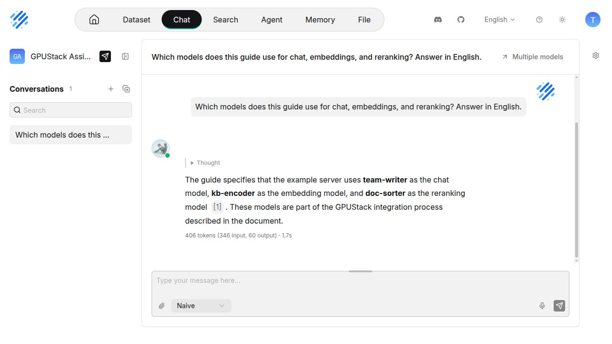

6. To have answers read aloud, turn on `Text to speech` under `Advanced settings` and click `Save`. Hover over an answer and click the speaker icon, which becomes a pause icon while the audio plays:

    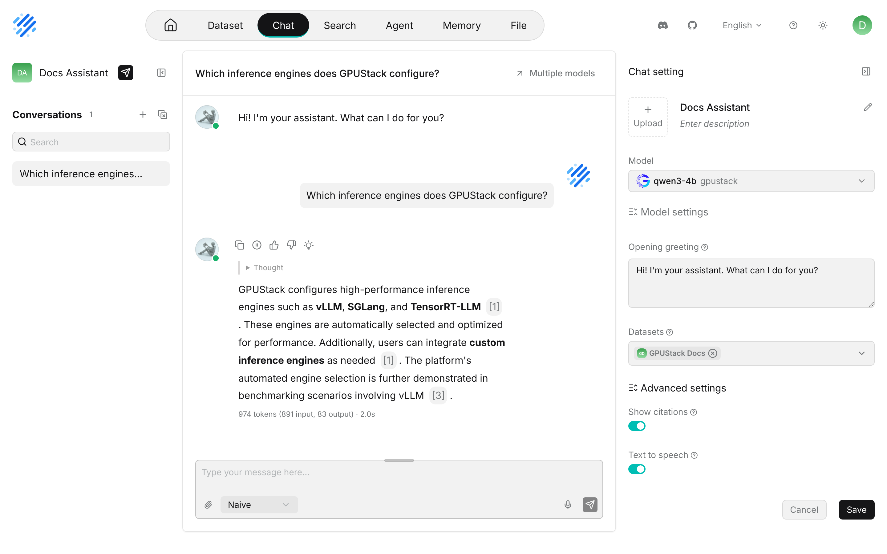

7. To use voice input, click the microphone icon in the message box, speak, and click the icon again to stop. RAGFlow transcribes the recording with the default Speech to text model and sends it as your message.

8. To chat about an image, switch `Model` to `qwen2.5-vl-3b-instruct` in the chat settings and clear `Datasets`, so that answers are not mixed with citations from unrelated documents. Click `Save`, start a new conversation, attach an image with the paperclip icon and send your question:

    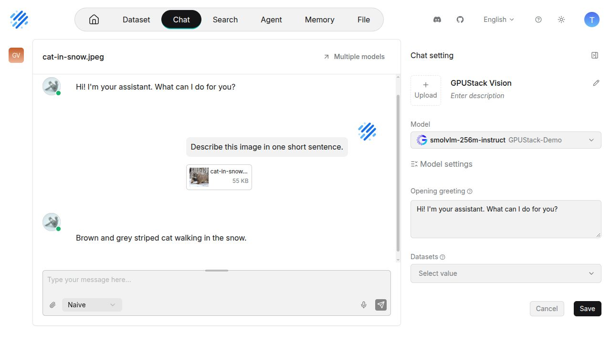
