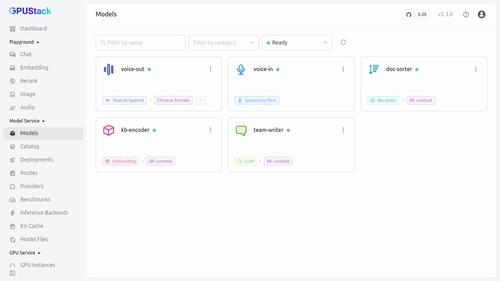
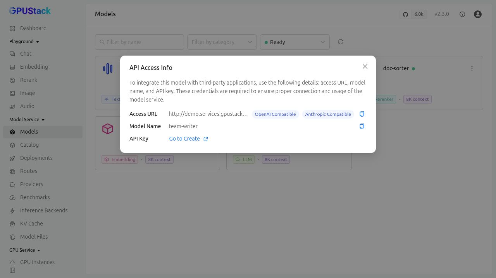
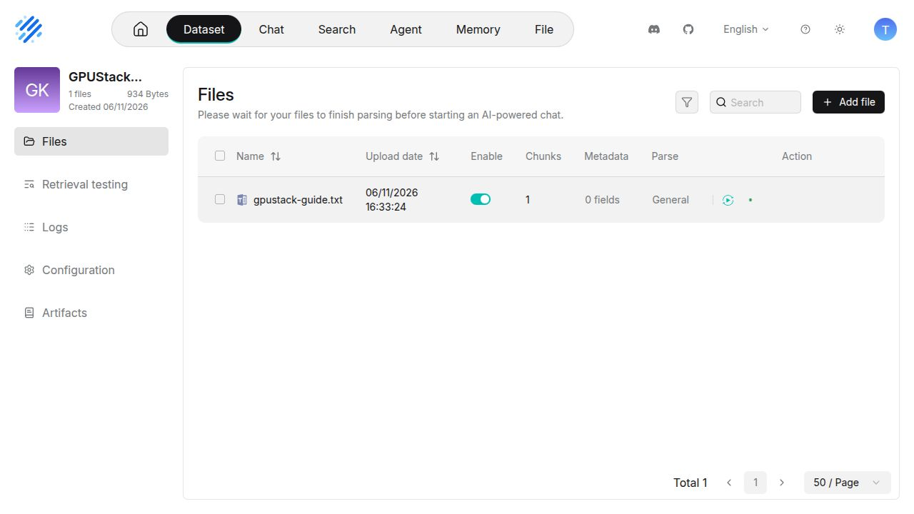

# Integrate with RAGFlow

RAGFlow can use GPUStack for locally deployed chat, embedding, reranking, speech-to-text, and text-to-speech models. Vision-capable chat models can also accept image input.

## Deploying Models

1. In GPUStack, navigate to `Model Service > Deployments` and click `Deploy Model`. Deploy the models required for your workflow and wait for their replicas to become ready.

The example below uses these deployment names. You can choose different names; RAGFlow discovers the names and model types from GPUStack.

| Deployment name | Model | Purpose |
| --- | --- | --- |
| `team-writer` | `Qwen/Qwen3-8B` | Chat |
| `kb-encoder` | `BAAI/bge-m3` | Embedding |
| `doc-sorter` | `BAAI/bge-reranker-v2-m3` | Reranking |
| `voice-in` | `Systran/faster-whisper-small` | Speech-to-text |
| `voice-out` | `gpustack/CosyVoice2-0.5B` | Text-to-speech |

Open `Model Service > Models` to view the ready models:

2. Click a model card to open `API Access Info`. This shows the access URL and the model name used by API clients.

## Create an API Key

1. Navigate to `Access Control > API Keys` and click `New API Key`.
2. Enter a name and save the key.
3. Copy the generated API key and keep it for the connection step below.

## Integrating GPUStack into RAGFlow

1. In RAGFlow, click the top-right account avatar to open user settings. Select `Model providers`, then `GPUStack`, and click `Add instance`.
2. Complete the connection form:

    - **Instance name:** Enter a unique name, such as `GPUStack-Demo`. Use letters, digits, underscores, or hyphens; do not include spaces.
    - **GPUStack server URL:** Enter the server root URL, such as `http://your-gpustack-host:port`. The example uses `http://demo.services.gpustack.ai:35090`. Do not append `/v1` in this field. Include the port if needed and ensure the URL is reachable from the RAGFlow container. Inside the RAGFlow container, `localhost` refers to the container itself, so it typically cannot be used to connect to a GPUStack instance running outside that container. Use a hostname or IP address reachable from the container instead.
    - **API key:** Paste the GPUStack API key created above.

3. Click `Connect`. RAGFlow discovers running models and groups them by model type. Select the models you need, verify their types, and click `Add N models`, where N is the number selected. Use `Refresh` on an existing instance to discover changes after deploying more models.
4. Open `Set default models` and select the appropriate GPUStack models. In this example, select `team-writer` for LLM, `kb-encoder` for Embedding, and `doc-sorter` for Rerank. Optionally select `voice-in` for ASR and `voice-out` for TTS. Selections are saved automatically.

### Create a Dataset and Test Retrieval

1. Open `Dataset` and click `Create dataset`. Enter a name, such as `GPUStack Knowledge`, select the GPUStack embedding model `kb-encoder`, and save.
2. In `Files`, select `Add file > Upload file`, enable `Parse on creation`, choose an English document, and click `Save`. Wait for parsing to finish and confirm that the document has chunks before testing retrieval or starting a chat.

3. Open `Retrieval testing`, select `doc-sorter` from the GPUStack instance as the `Rerank model`, enter a question about the document, and click `Run`. Check that the results contain the relevant passages. Retrieval testing settings are not automatically applied to a chat assistant; configure them separately in the assistant when needed.

### Chat with the Dataset

1. Open `Chat`, click `Create chat`, and enter a name, such as `GPUStack Assistant`.
2. Open the chat and click the settings icon. Select `team-writer` from the GPUStack instance as the `Model`, choose `GPUStack Knowledge` under `Datasets`, and click `Save`.

3. In `Chat setting`, expand `Advanced settings > Naive`. Set `Rerank model` to `doc-sorter` from the GPUStack instance, then click `Save`. This applies reranking to this chat's dataset retrieval.

4. Start a conversation and ask a question about the uploaded document. Review the response and its source citations.

### Enable Image Input

Image input requires a vision-capable model deployed in GPUStack. The example below uses `HuggingFaceTB/SmolVLM-256M-Instruct`, deployed as `smolvlm-256m-instruct`, in a separate chat named `GPUStack Vision`.

1. Deploy a vision-capable model in GPUStack, then refresh its instance in RAGFlow and add the model.
2. In `Model providers > GPUStack`, set that model's type to `Chat + Vision`. GPUStack's model type alone does not identify image support; only choose this type for a model that actually accepts images.
3. Create a chat, select the vision-capable model in `Chat setting`, and click `Save`. You can leave `Datasets` empty for a standalone image question.
4. Start a new conversation, click the attachment button, and upload an image. Enter a prompt such as `Describe this image in one short sentence.` and send it. Confirm that the response describes the image.

