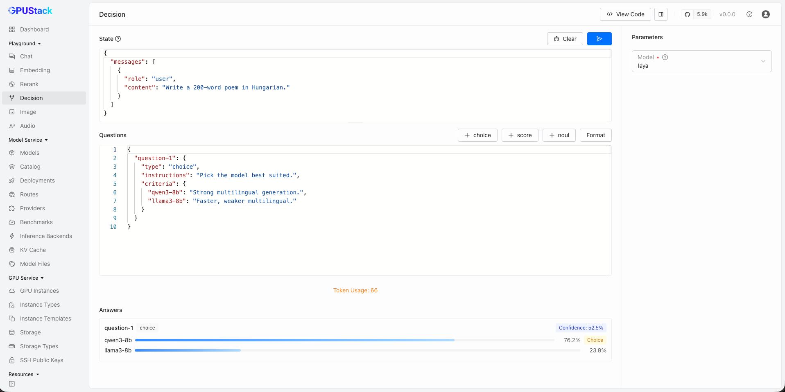

# Decision Playground

The Decision Playground allows you to test decision models that answer typed questions against a given state. Compose the state and the questions, run them against a deployed decision model, and review the typed answers, with code examples for API integration.

## State

The `State` editor holds the situation the decision is made against — plain text, or a JSON object/array such as chat messages. The editor validates JSON as you type; the state is required to run.

## Questions

The `Questions` editor holds the questions asked about the state, as a JSON object mapping a question id to a question definition. Use the `+ choice`, `+ score`, and `+ noul` buttons to insert runnable templates:

- `choice` — pick one option from `criteria` (option name → description).
- `score` — score the state against an ordered list of levels in `criteria`.
- `noul` — a binary (yes/no) question.

The editor validates JSON and offers schema hints, but the question set stays open — engine-specific fields are passed through as-is.

## Run

Select a decision model, then click the `Run` button or press `Ctrl`/`Cmd` + `Enter` to send the state and questions to `/v1/systemone`. Click `Stop` to cancel a running request.

## Answers

Each answer comes back under its question id, rendered as a card: the verdict (`Choice`, `Score`, or a yes/no tag for `noul`), its `Confidence`, and the per-option probabilities. A summary line above the cards shows which model answered and the token usage. Unrecognized answer shapes fall back to a raw JSON view.

## Select Model

Select an available decision model in GPUStack by clicking the model dropdown at the top-right corner of the playground UI. Only models in the `decision` category are listed — if a model is missing, make sure it is running and correctly categorized, and adjust the category in the model's settings if needed.

## View Code

After composing the state and questions, click the `View Code` button to see how to call the API with the same input. Code examples are provided in `curl`, `Python`, and `Node.js`.
