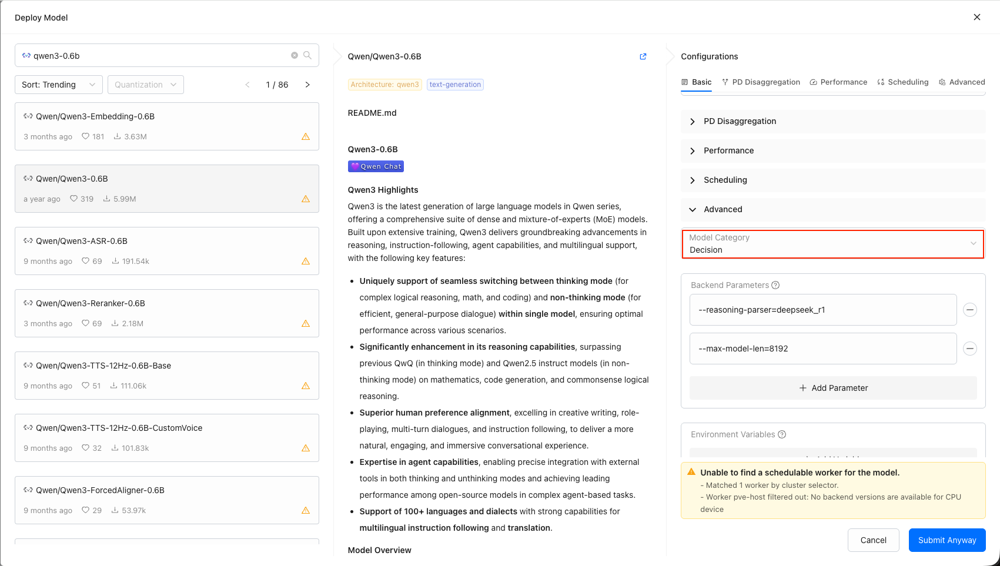
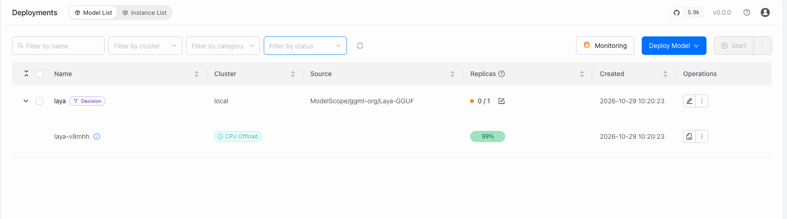

# Using Decision Models

**Decision models** answer structured, typed questions instead of generating text. Given a *state* — the situation the decision is made against — and a set of *questions*, a decision model returns a typed verdict per question: a picked option, a level score, or a yes/no answer, usually with confidence values. They are used where a full generation is wasteful, such as model selection and routing, classification, and lightweight judging tasks.

In GPUStack, decision models are served through the System One (Jev) decision contract at the `/v1/systemone` endpoint. In this guide, we will demonstrate how to deploy and use decision models in GPUStack.

## Prerequisites

Before you begin, ensure that you have the following:

- GPUStack is installed and running. If not, refer to the [Quickstart Guide](../quickstart.md).
- Access to Hugging Face for downloading the model files.

## Step 1: Deploy the Model

GPUStack currently supports two kinds of deployments serving the decision API:

### vLLM: Repurpose a Text Generation Model

vLLM `0.32.0` and later serve the System One decision contract on their regular serving port. Deploy any text generation model with the `vLLM` backend as usual, then change the model's category to `Decision` — the category is what tells GPUStack the deployment is a decision service.

1. Deploy a text generation model with the `vLLM` backend (version `0.32.0` or later). See [Model Deployment Management](../user-guide/model-deployment-management.md).
2. Edit the model, and set `Category` to `Decision` in the model's settings.



### llama.cpp: Serve a Laya Decision GGUF

Laya decision GGUF files carry a decision metadata key on an otherwise generic backbone (modern-bert, qwen, llama). Deploy the GGUF like any other GGUF model and it is served by llama.cpp: GPUStack detects the decision metadata during deployment and files the model under the `decision` category automatically — without it, the same file would be misread as a reranker or embedding model.



Either way, the `Category` column on the `Models` page shows `Decision` once the deployment is up. The category can also be corrected manually; category values are validated, so a mistyped category is rejected rather than silently stored.

## Step 2: Ask a Decision

You can ask a decision either in the UI or through the API.

### Via the UI

1. Go to `Playground` > `Decision`, or click `Open in Playground` on the model's row in the `Models` page.
2. Select the decision model from the model selector — only models in the `decision` category are listed, and the model is the only parameter a decision takes.
3. Fill in the `State` editor with the situation to decide against — it is seeded with a chat-messages sample and accepts plain text or structured JSON — and the `Questions` editor with the questions to ask, seeded with a `choice` question and extendable with the `+ choice`, `+ score`, and `+ noul` buttons.
4. Click `Run` (or press `Ctrl`/`Cmd` + `Enter`) and read the typed answers.

See [Decision Playground](../user-guide/playground/decision.md) for details on the editors and the answer cards.

### Via the API

Send a state and questions to the model via `POST /v1/systemone` (authenticate with an API key created on the `API Keys` page). The `model` field is required and carries the deployed model's name (or a model route name), like the OpenAI-compatible endpoints.

Here is an example script using `curl`:

```bash
export SERVER_URL=<your-server-url>
export GPUSTACK_API_KEY=<your-api-key>
curl $SERVER_URL/v1/systemone \
    -H "Content-Type: application/json" \
    -H "Authorization: Bearer $GPUSTACK_API_KEY" \
    -d '{
        "model": "qwen3-decision-8b",
        "state": {
            "messages": [
                { "role": "user", "content": "Write a 200-word poem in Hungarian." }
            ]
        },
        "questions": {
            "model_selection": {
                "type": "choice",
                "instructions": "Pick the model best suited.",
                "criteria": {
                    "qwen3-8b": "Strong multilingual generation.",
                    "llama3-8b": "Faster, weaker multilingual."
                }
            }
        }
    }' | jq
```

Replace `<your-server-url>` with the URL of your GPUStack server and `<your-api-key>` with an API key created on the `API Keys` page.

Example response:

```json
{
  "model": "qwen3-decision-8b",
  "usage": {
    "input_tokens": 189,
    "output_tokens": 12
  },
  "answers": {
    "model_selection": {
      "type": "choice",
      "choice": "qwen3-8b",
      "confidence": 0.93,
      "probabilities": {
        "qwen3-8b": 0.93,
        "llama3-8b": 0.07
      }
    }
  }
}
```

Each entry under `questions` maps a question id to one of three conventional types, and the answer for a question comes back under the same id in `answers`:

| Type | Meaning | `criteria` | Answer field |
| --- | --- | --- | --- |
| `choice` | Pick one option | Option name → description | `choice` — the picked option name |
| `score` | Score the state against ordered levels | Ordered list of level descriptions | `score` — the level index |
| `noul` | Binary (yes/no) question | Optional descriptions for the `true` / `false` sides | `noul` — a boolean |

GPUStack resolves the `model` field and passes the rest of the request body, and the whole response, through to the decision engine untouched — the question set is open in the contract and engines may accept further fields.

## Next Steps

- A deployed decision model can serve as the decision service of a route's [Decision Service Routing](../user-guide/model-route-management.md#decision-service-routing) policy, scoring route targets per request.
- For the full endpoint reference, see [Inference APIs](../integrations/inference-apis.md).
